# Architecture review: deepening opportunities

**Date:** 26 October 2026
**Scope:** the main working tree of `miseflow` (`shared/`, `server/`, `web/`, `e2e/`), weighted by the last six weeks of history (232 commits).
**Domain vocabulary:** `CONTEXT.md`.
**Architecture vocabulary:** module, interface, implementation, depth, seam, adapter, leverage, locality. A **module** is anything with an interface and an implementation; **depth** is leverage at the interface; a **seam** is where a module's interface lives.

This review surfaces architectural friction and proposes **deepening opportunities**: refactors that turn shallow modules into deep ones. It does not propose interfaces yet. Pick a candidate first; the interface follows from the constraints.

## Summary

| # | Candidate | Strength | Dependency category |
|---|---|---|---|
| 1 | Extract the Plan read model from the re-plan module | Strong | in-process |
| 2 | One Task shape module for Step time | Strong | in-process |
| 3 | Give the browser a Plan preview interface | Worth exploring | in-process |
| 4 | One catalog visibility seam | Strong | in-process |
| 5 | A Plan display vocabulary module | Worth exploring | in-process |
| 6 | One owner contract for Dish and Batch Tasks | Speculative | in-process |

Strength: **Strong** means the friction is measured and the deletion test concentrates complexity. **Worth exploring** means the friction is real but the shape needs a conversation. **Speculative** means the duplication is real, but the payoff is smaller than the others.

## Where the friction is

The most-changed source files in the last six weeks are also the files that carry the duplicated rules:

| File | Changes | What it owns |
|---|---:|---|
| `shared/src/scheduler/schedule.ts` | 18 | Greedy backward scheduler and conflicts |
| `shared/src/mutators/registry.ts` | 17 | The named-mutation table (ADR 0007) |
| `shared/src/index.ts` | 17 | The shared barrel |
| `shared/src/plan/replan.ts` | 13 | Re-plan write sequence and the Plan read |
| `shared/src/scheduler/types.ts` | 8 | Scheduler input and output types |
| `shared/src/plan/model.ts` | 7 | Rows to `PlanningModel`, Task totals |
| `web/src/PlanScreen.tsx` | 7 | Plan read, Gantt, optimistic pin |
| `web/src/MenuScreen.tsx` | 7 | Menu editing, Batch factor display |

`registry.ts` and `index.ts` are aggregation points where every new mutation or export lands; their churn is the cost of ADR 0007 and is not itself a candidate. `schedule.ts`, `replan.ts` and `model.ts` are the hot spots where the same rules appear more than once.

The test surface is uneven. The scheduler has a 1,298-line test file and runs without a database. The Plan read has no test of its own: it is fused to a transaction. The web has unit tests for two pure helpers (`need.ts`, `quick-fixes.ts`) and relies on Playwright for every screen. Server route tests go through the HTTP seam but also write the database directly: `mutate.test.ts` has 14 direct DB statements, `shopping.test.ts` has 8.

---

## 1. Extract the Plan read model from the re-plan module

**Strength:** Strong · **in-process**

**Files**

- `shared/src/plan/replan.ts:356–422` — `PlanRead` and `PlanTask`
- `shared/src/plan/replan.ts:429–569` — `readPlan`
- `shared/src/plan/model.ts` — `PlanRows`
- `server/src/routes/services.ts:22` — the only production caller

**Problem.** The Plan read — every name, label, day grouping and sentence — is assembled inside the file that mutates the stored Plan. `replan.ts` is 569 lines and owns both `replanWith` (lock, load, reconcile, schedule, diff, write) and `readPlan` (names, labels, days, behind, unplaced, conflicts), plus the public `PlanRead`/`PlanTask` contract. The read contract cannot move without touching the write path's file.

**Solution.** Make the read a pure function over `PlanRows`; the database fetch stays a thin caller. The read module owns `PlanRead` and `PlanTask`. `replanWith` keeps only the write sequence.

**Before**

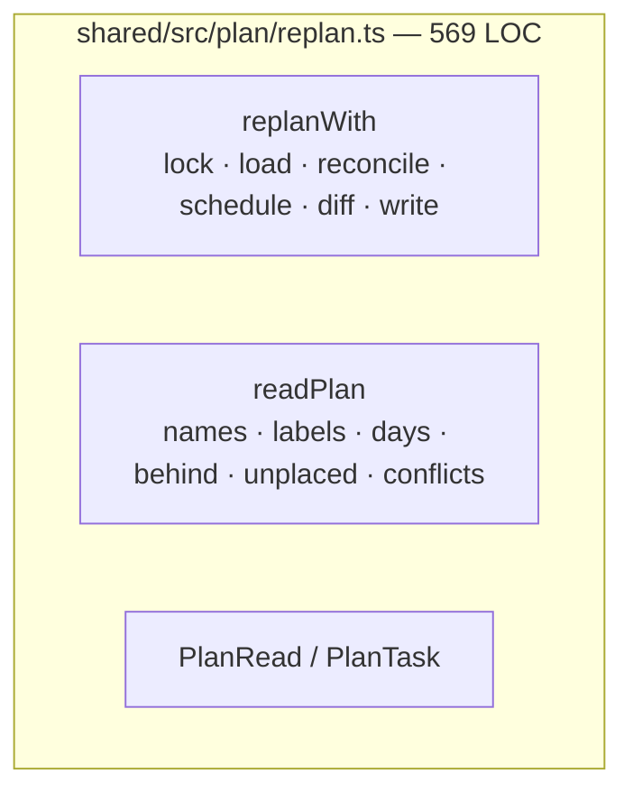

**After**

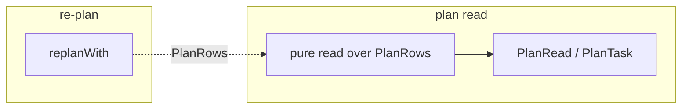

**Wins**

- Tests read `PlanRows`, not Postgres.
- locality: the read contract has one home.
- The write module loses about 140 lines.
- leverage: one fixture covers every Plan screen.
- `PlanRead` types move without touching `replanWith`.

**ADR note.** ADR 0010 says the Plan is derived on read. It does not say the derivation belongs in the write module. This is packaging, not a reopened decision.

---

## 2. One Task shape module for Step time

**Strength:** Strong · **in-process**

**Files**

- `shared/src/scheduler/schedule.ts:16–17, 42–44, 51–108`
- `shared/src/plan/model.ts:85–86, 159–169`
- `shared/src/plan/more-time.ts:13–30`
- `shared/src/plan/behind.ts:30`
- `shared/src/plan/axis.ts:122`

**Problem.** A Step's duration, passive time, 10-minute placeholder and 5-minute grid are copied across four modules. `schedule.ts` defines `GRID`, `PLACEHOLDER_ACTIVE`, `roundUp`, `floorGrid` and `ceilGrid`; `model.ts` repeats the placeholder and rounding for `TaskInfo`; `more-time.ts` re-implements the same shape in `shapeOf` so it can propose an Availability override; `behind.ts` re-derives the due time from the same totals; `axis.ts` has its own `snap5`. One timing rule is a four-file change, and the constants are duplicated verbatim.

**Solution.** One pure module turns Steps into a Task's shape — duration, active stretches, active and passive totals, trailing passive time, approximate — and owns grid rounding. The scheduler, the planning model, the more-time search, behind and the Gantt axis all cross that seam.

**Before**

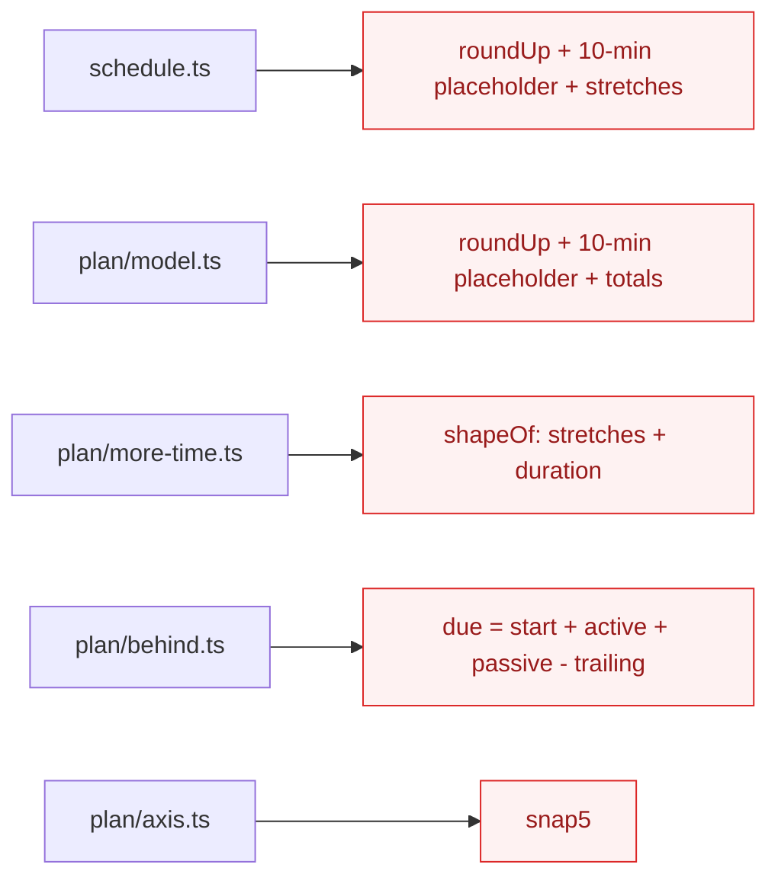

**After**

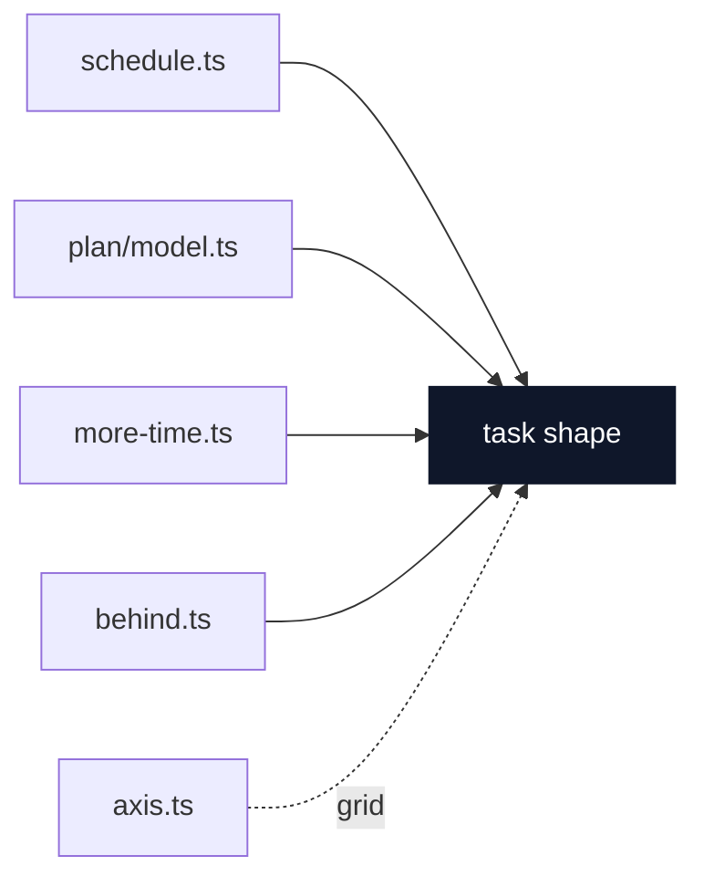

**Wins**

- locality: Step timing changes once.
- Four copies collapse into one.
- Tests hit one shape interface.
- The hottest file shrinks.
- Grid rounding stops drifting.

---

## 3. Give the browser a Plan preview interface

**Strength:** Worth exploring · **in-process**

**Files**

- `web/src/PlanScreen.tsx:1–2, 60–66`
- `shared/src/plan/pin.ts` — `withPin`, `applyPlacements`
- `shared/src/plan/replan.ts:380–388` — `PlanRead.model`
- `shared/src/scheduler/schedule.ts`

**Problem.** The Plan screen must know the scheduler's input type and three internal modules to preview one drag. It deep-imports `plan/pin.ts` and `scheduler/schedule.ts`, calls `withPin` and `applyPlacements`, and reads `PlanRead.model`. The scheduler's input type therefore crosses the public read seam. Across the web, there are 14 deep imports of `@miseflow/shared/src/...` and zero imports from the shared barrel.

**Solution.** One preview module takes the read Plan and a pin, and returns the read Plan with placements laid over it. The scheduler input leaves the public read, and the screen crosses one seam instead of three.

**Before**

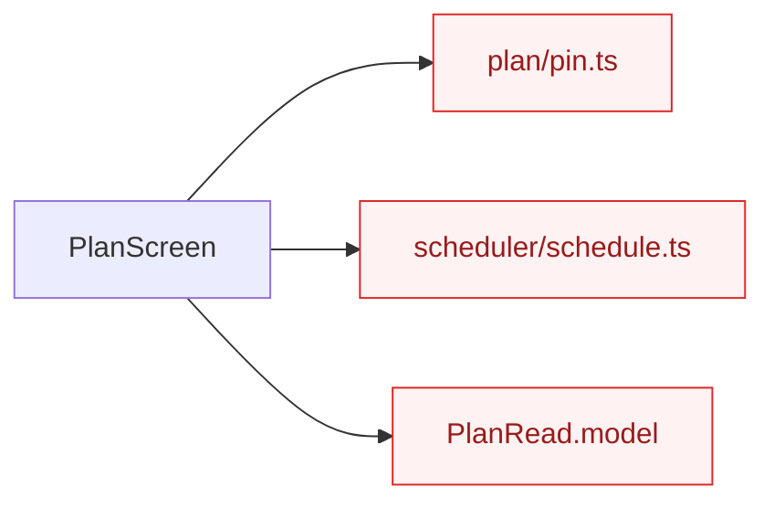

**After**

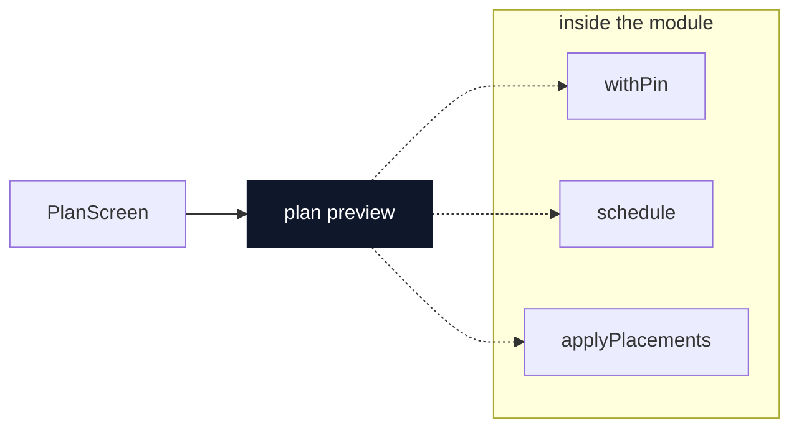

**Wins**

- Interface shrinks: `model` leaves `PlanRead`.
- The screen stops importing scheduler internals.
- One call, three modules hidden.
- A drag is tested through one interface.
- leverage: the Gantt and the Plan share the preview.

**ADR note.** ADR 0005 makes the browser a first-class consumer of shared logic. Today it reaches in through file paths. This deepens the seam the ADR already intends.

---

## 4. One catalog visibility seam

**Strength:** Strong · **in-process**

**Files**

- `shared/src/catalog/load.ts:22–30`
- `shared/src/shopping/read.ts:24–25`
- `shared/src/mutators/steps.ts:333–353`
- `shared/src/mutators/ingredients.ts:187–223`

**Problem.** "Visible" is written four times and means two different things. `catalog/load.ts` and `shopping/read.ts` accept any row whose `ownerId` is null or the caller's, with no `source` check. `mutators/steps.ts` and `mutators/ingredients.ts` accept an ownerless row only when `source = 'seed'`. The two readings are not identical: a non-seed row with no owner is visible to reads and invisible to writes. The rule is load-bearing for Ingredient lines (ADR 0002) and the shared seed (ADR 0003).

**Solution.** One module owns the predicate and the require-helpers. Reads and mutators both cross the same seam, so there is one meaning of visible.

**Before**

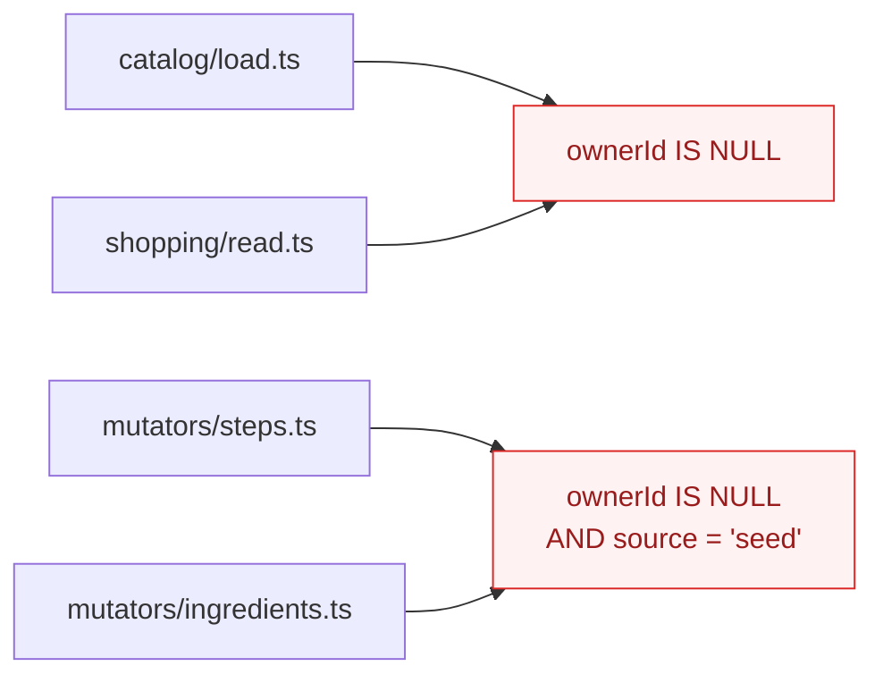

**After**

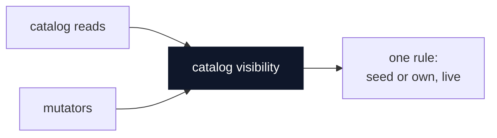

**Wins**

- One meaning of visible.
- locality: the seed-or-own rule in one module.
- Mutators and reads share the seam.
- Tests cover both callers once.
- Deletion test: the copies vanish.

---

## 5. A Plan display vocabulary module

**Strength:** Worth exploring · **in-process**

**Files**

- `web/src/PlanScreen.tsx:11–26, 28–42`
- `web/src/TodayScreen.tsx:9–22`
- `web/src/PrintedPlan.tsx:4`

**Problem.** Two screens each define the same day heading and owner line. `PlanScreen` has `dayHeading`, `shortDay`, `ownerOf` and a local `passive` formatter; `TodayScreen` has `dayHeading`, `shortDay`, `ownerOf` and `taskTimes`; `PrintedPlan` imports its formatters from `TodayScreen`. A screen module doubles as a utility module, and the printed and on-screen lines can drift.

**Solution.** One small formatting module owns the Plan's day and task lines. Screens render; they no longer define the vocabulary.

**Before**

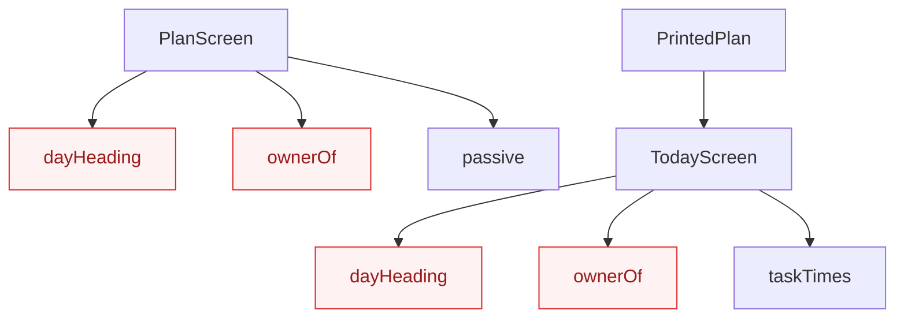

**After**

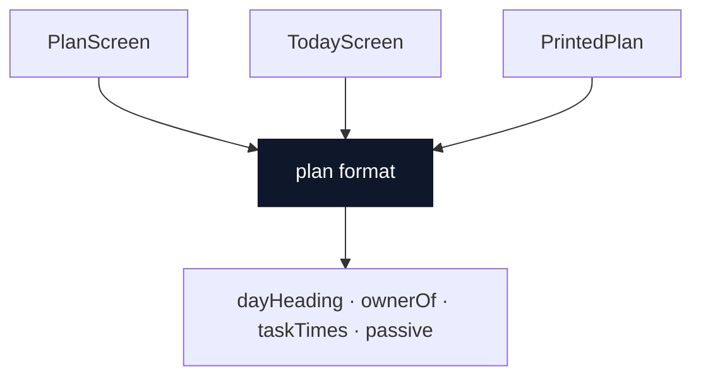

**Wins**

- Screens stop importing screens.
- One day-heading rule.
- locality: formatting changes once.
- Printed and on-screen lines agree.
- Tests format through one interface.

---

## 6. One owner contract for Dish and Batch Tasks

**Strength:** Speculative · **in-process**

**Files**

- `shared/src/scheduler/types.ts:11–14` — `Owner`
- `shared/src/mutators/pins.ts:13–16`
- `shared/src/mutators/progress.ts:10–13`
- `shared/src/mutators/services.ts:221–224`

**Problem.** The Dish-or-Batch owner is declared as a type once and as a runtime schema three times. A new owner kind is four edits, and the wire schema can drift from the domain type without a type error.

**Solution.** One module exports the owner type and the schema that validates it. Every mutator imports both from there.

**Before**

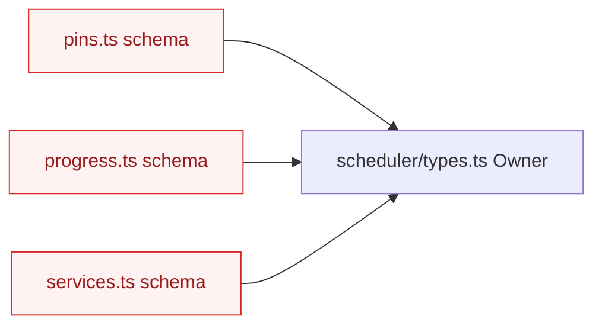

**After**

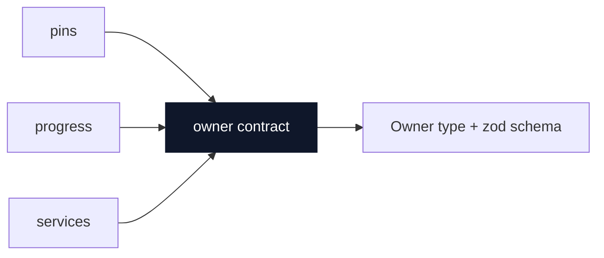

**Wins**

- One owner contract.
- Validation follows the type.
- A new owner kind is one edit.
- Wire schema and domain type agree.
- Tests build owners once.

---

## Top recommendation

**Start with [One Task shape module](#2-one-task-shape-module-for-step-time).**

`shared/src/scheduler/schedule.ts` is the most-changed source file in the repo (18 changes in six weeks), and the rule it encodes is copied into three other modules. Concentrating Step timing first turns every later scheduler change — including the Plan read extraction — into a one-module edit, and gives the hottest logic a test surface that is not a 1,298-line scheduler test file.

The natural second step is [Extract the Plan read model](#1-extract-the-plan-read-model-from-the-re-plan-module): it is the largest single reduction in `replan.ts` and it gives the read a pure test surface without a database. Candidate 3 becomes easier once the read contract has its own home.

## Not proposed here

- Interfaces for the deepened modules. Those follow from the constraints, once a candidate is chosen.
- A new seam for the scheduler. It already has one, and two consumers (the write path and the browser preview) justify it.
- Changes to ADR 0007's mutation registry. Its churn is the cost of a deliberate single write seam, not a depth problem.
- A rewrite of the web screens. They are rendering code covered by the e2e; the friction is in the vocabulary they duplicate, not in their size.

## Next step

Pick one candidate and walk its decision tree: constraints, dependencies, the shape of the deepened module, what sits behind the seam, what tests survive. The other candidates can follow as separate tickets once the first lands.
