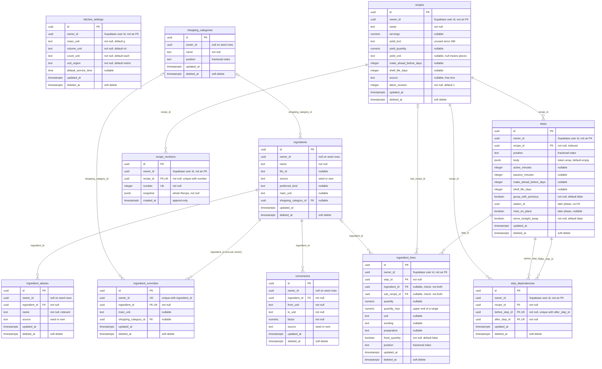

# Database: catalog and recipes

The Ingredient catalog and Recipe tables from `shared/src/schema.ts` (Drizzle, Postgres). The
other half of the schema (Menus, Services, Batches, Cooks, the Plan) is in
[database-menus-and-planning.md](database-menus-and-planning.md).

## How to read it

- **Ids and owners.** Every `id` is a browser-made uuid and the only primary key. `owner_id` is the
  Supabase Auth user id. It is not a foreign key: there is no users table in this schema, and reads
  and writes scope by it in code (for example `eq(recipes.ownerId, ownerId)` in
  `shared/src/mutators/revision.ts`). `kitchen_settings` has no foreign keys at all; it holds the
  kitchen's Main unit per kind of measure and the default Service time.
- **Soft deletes.** Every table here except `recipe_revisions` has `deleted_at`; a row is removed by
  setting it, and reads filter on `deleted_at is null`. Foreign keys are all `ON DELETE no action`,
  so a soft-deleted parent still satisfies them. ADR 0010 notes that an Ingredient line pointing at
  a soft-deleted sub-recipe reads as a Missing sub-recipe.
- **Seed rows and kitchen rows share tables.** `shopping_categories`, `ingredients`,
  `ingredient_aliases` and `conversions` hold both. Seed rows have `owner_id` null (and
  `source = 'seed'` where the table has a `source` column); they are loaded by `server/src/seed.ts`
  and never edited. A kitchen sees seed rows plus its own live rows (`visibleTo` in
  `shared/src/catalog/visibility.ts`). A kitchen's change to a seed Ingredient (its Main unit or
  Shopping category) goes in `ingredient_overrides`, unique on (`owner_id`, `ingredient_id`), so
  the ODbL seed stays untouched.
- **Ingredient lines point at one target.** A line belongs to a Step and links either to an
  Ingredient (`ingredient_id`) or to another Recipe used as a sub-recipe (`sub_recipe_id`). The
  check `ingredient_lines_one_target` forbids both; neither set means a Missing sub-recipe.
- **Revisions.** The working copy is the normalized rows (`recipes`, `steps`, `ingredient_lines`,
  `step_dependencies`). Every edit mutation bumps `recipes.latest_revision` and appends one
  `recipe_revisions` row holding a jsonb snapshot of the whole Recipe, in the same transaction
  (`appendRevision` in `shared/src/mutators/revision.ts`). The table is append-only, so it has
  `created_at` but no `updated_at` or `deleted_at`, and (`recipe_id`, `number`) is unique.
- **Step dependencies** are manual finish-to-start links: `before_step_id` must finish before
  `after_step_id` starts. Each pair is unique.
- **Referenced from the other half of the schema.** `dishes.recipe_id` and `batches.sub_recipe_id`
  point at `recipes`; `task_placements.first_step_id` and `step_events.step_id` point at `steps`;
  `shopping_marks.ingredient_id` points at `ingredients`. Those tables are drawn in
  [database-menus-and-planning.md](database-menus-and-planning.md).

## Source files

- [shared/src/schema.ts](../../../shared/src/schema.ts): the Drizzle table definitions
- [shared/migrations/0000_soft_ezekiel_stane.sql](../../../shared/migrations/0000_soft_ezekiel_stane.sql): the generated tables, foreign keys and checks
- [shared/migrations/0002_sleepy_praxagora.sql](../../../shared/migrations/0002_sleepy_praxagora.sql): the `ingredient_overrides` unique constraint
- [shared/migrations/0003_oval_white_tiger.sql](../../../shared/migrations/0003_oval_white_tiger.sql): `ingredient_lines.quantity_max`
- [shared/migrations/0004_sharp_maelstrom.sql](../../../shared/migrations/0004_sharp_maelstrom.sql): `recipes.yield_quantity` and `yield_unit`
- [shared/src/catalog/visibility.ts](../../../shared/src/catalog/visibility.ts): which seed and own catalog rows a kitchen sees
- [shared/src/mutators/revision.ts](../../../shared/src/mutators/revision.ts): Recipe locking and Revision snapshots
- [server/src/seed.ts](../../../server/src/seed.ts): loads the ownerless seed rows
- [docs/adr/0010-mvp-schema.md](../../adr/0010-mvp-schema.md): the MVP schema decisions
- [docs/adr/0002-ingredient-lines-link-to-ingredients.md](../../adr/0002-ingredient-lines-link-to-ingredients.md): why lines link to an Ingredient
