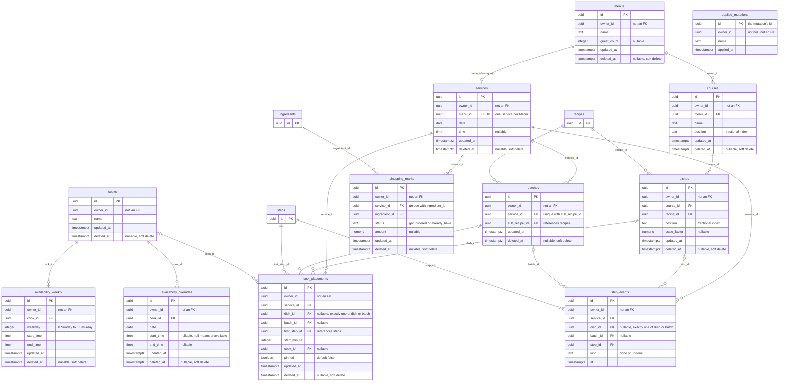

# Database: menus, services and planning

The Menu, Service, Cook and Plan tables in `shared/src/schema.ts`, with their columns and foreign
keys. `recipes`, `steps` and `ingredients` appear only as stubs (their `id`) because rows here
point at them; their full columns are in [Database: catalog and recipes](database-catalog-and-recipes.md).

Columns are not null unless marked nullable. Every `id` is a browser-made uuid. `owner_id` is a
plain uuid column with no foreign key in the schema or the migrations; it is nullable everywhere
except `applied_mutations`. No foreign key has an `ON DELETE` action (all are `no action`), and
rows are soft-deleted through `deleted_at` instead.

## What each group stores

- **Menus and Dishes.** A Menu (`menus`) has ordered Courses (`courses`), and each Course has
  ordered Dishes (`dishes`), each pointing at the Recipe it serves, with an optional Scale factor.
- **Services and Batches.** A Service (`services`) is the dated event for a Menu. In the MVP
  `services.menu_id` is unique, so a Menu has at most one Service. `batches` holds one row per
  sub-recipe per Service (unique on `service_id, sub_recipe_id`), so pins and progress have a
  Batch id to hang off.
- **Cooks and availability.** `cooks` lists the Cooks. `availability_weekly` gives a Cook's
  hours per weekday; `availability_overrides` replaces them on one date, where a null start and
  end means the Cook is unavailable.
- **The Plan.** `task_placements` stores one row per placed Task: the Task is keyed by its
  Service, its Dish or Batch (a check requires exactly one) and its first Step, with a
  `NULLS NOT DISTINCT` unique constraint on those four columns. Each row holds the start minute,
  the optional Cook and the `pinned` flag for Tasks the user pinned.
- **Progress.** `step_events` is append-only (no `updated_at` or `deleted_at`): each row records a
  Step of a Dish or Batch being marked `done` or `undone` at a time, and a Step's state is its
  latest event. It is indexed on `service_id`.
- **Shopping status.** `shopping_marks` holds one mark per Service and Ingredient (unique on
  `service_id, ingredient_id`), with a status of `got`, `ordered` or `already_have` (the MVP writes
  only `got`) and an optional amount.
- **Idempotency.** `applied_mutations` is append-only with one row per applied named mutation,
  whose `id` is the mutation's id, so a retried mutation is applied once (ADR 0007). It has no
  foreign keys.

## Source files

- [shared/src/schema.ts](../../../shared/src/schema.ts): the Drizzle table definitions
- [shared/migrations/](../../../shared/migrations/): the generated SQL, including the foreign keys
  and constraints
- [docs/adr/0010-mvp-schema.md](../../adr/0010-mvp-schema.md): why the schema has this shape
- [docs/adr/0007-writes-are-named-mutations-to-one-endpoint.md](../../adr/0007-writes-are-named-mutations-to-one-endpoint.md):
  named mutations and the idempotency they rely on
