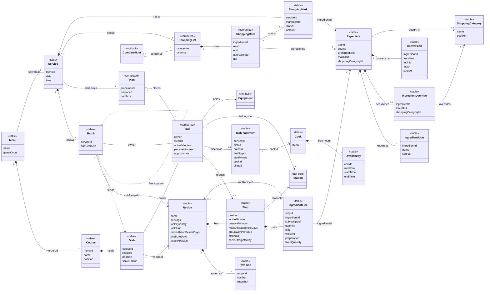

# Domain model

The glossary in `CONTEXT.md` drawn as classes, with each one marked by how the code holds it today:

- `<<table>>`: stored as a table in `shared/src/schema.ts` (attribute names are the Drizzle field names).
- `<<computed>>`: derived in code on every read, never stored (attribute names are the TypeScript field names).
- `<<not built>>`: in the glossary only. Nothing in `shared/`, `server/` or `web/` models it yet.

## Reading the diagram

- **Recipe, Revision, Step, Ingredient line.** Every edit writes a whole-Recipe `snapshot` to `recipe_revisions` (append-only, numbered per Recipe). Ingredient lines hang off a Step (`step_id`), not the Recipe directly. A line points at an Ingredient *or* a sub-recipe (`sub_recipe_id`, another Recipe), never both; neither set is a **Missing sub-recipe**.
- **Ingredient catalog.** Seed and own rows share the `ingredients`, `ingredient_aliases` and `conversions` tables, told apart by `source`. A kitchen's changes to a seed Ingredient go in `ingredient_overrides`, one row per kitchen and Ingredient. The schema allows a null `shopping_category_id`, although the glossary says every Ingredient has one.
- **Menu, Service.** The glossary allows several Services per Menu; the MVP's `services.menu_id` is unique, so it's 1 to 1 for now.
- **Batch.** Stored as one row per Service and sub-recipe (`batches_service_sub_recipe`), so splitting and merging Batches aren't built yet. Its Scale factor and the Dishes or parent Batches it feeds aren't stored: `deriveBatches` (`SizedBatch.parents`) works them out on each read, hence the dashed `feeds` links.
- **Task, Pin, Plan.** A Task is computed from a Dish's or Batch's Step groups (`TaskSpec`, `TaskInfo`, `taskShape`). Only its placement is stored in `task_placements`, keyed by Service, owner and first Step, with `pinned` holding the **Pin** and `cook_id` the Cook. The **Plan** (placements, Unplaced Tasks, conflicts) is the scheduler's output and isn't stored. Step progress is stored as `step_events` (done or undone), not drawn here.
- **Cook, Availability.** Availability is two tables: weekly hours (`availability_weekly`, drawn) and per-date exceptions (`availability_overrides`, where null hours mean unavailable). The planning model takes exactly one Cook in the MVP.
- **Shopping.** The Shopping list and its rows are computed on read (`ShoppingList`, `ShoppingRow`). Only the **Shopping status** is stored, in `shopping_marks`, one per Service and Ingredient: `status` is `got`, `ordered` or `already_have` (the MVP writes only `got`), and the absence of a mark means To buy.

**Left out or not built:**

- *Not built, drawn:* **Station** (only an unlinked `steps.station_id` column, no table), **Equipment**, **Combined list**.
- *Not built, left out:* Dish override, Bought batch, Mise en place task and line (only a `steps.mise_en_place` flag), Pack size, Trim loss, Staple, Fire and Course states.
- *Left out to keep the diagram readable:* Step dependencies (`step_dependencies`), Step events, Availability overrides, Kitchen settings (units and Unit region), Quantity and unit terms, Recipe file and Import preview, and the views (Board, Prep view, Today checklist, Station prep list).

## Source files

- [CONTEXT.md](../../../CONTEXT.md)
- [shared/src/schema.ts](../../../shared/src/schema.ts)
- [shared/src/recipe/snapshot.ts](../../../shared/src/recipe/snapshot.ts)
- [shared/src/task/shape.ts](../../../shared/src/task/shape.ts)
- [shared/src/task/owner.ts](../../../shared/src/task/owner.ts)
- [shared/src/plan/model.ts](../../../shared/src/plan/model.ts)
- [shared/src/plan/batches.ts](../../../shared/src/plan/batches.ts)
- [shared/src/scheduler/types.ts](../../../shared/src/scheduler/types.ts)
- [shared/src/shopping/list.ts](../../../shared/src/shopping/list.ts)
