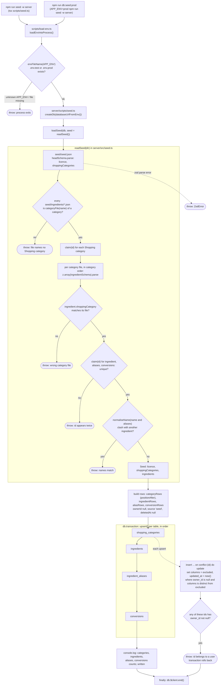

# Ingredient seed pipeline

## How it works

`server/scripts/seed.ts` imports `scripts/load-env.ts` first, which loads exactly one env file picked by `APP_ENV` (`.env.test` when unset or `test`, `.env.prod` for `db:seed:prod`), then opens the database with `DATABASE_URL`. `loadSeed(db)` calls `readSeed()` on `server/seed/`: `seed.json` holds the ODbL licence notice and the ordered Shopping categories, and `ingredients/<slug>.json` holds one category's Ingredients (slug from `categoryFile`, e.g. "Meat & fish" becomes `meat-and-fish.json`). Every file is checked with zod strict schemas; `readSeed` also throws on a JSON file that names no category, an Ingredient in the wrong category file, any id used twice across categories, Ingredients, aliases and Conversions (`claim`), and two Ingredients whose names or aliases match after `normaliseName`.

`loadSeed` turns the seed into rows with `ownerId: null`, `source: "seed"` and `deletedAt: null` (categories get a fractional `position` from `positionAfter`), then upserts all four tables in one transaction. After each insert, `upsert` checks whether any of those ids belongs to a user row (`owner_id is not null`); if so it throws and the whole transaction rolls back. Either way the script closes the connection in `finally`; a thrown error ends the run with a non-zero exit.

**Idempotency:** a conflicting row is only rewritten when it has no owner and its columns differ from the file, so a second run writes nothing, `written` is 0 and `updated_at` is kept.

**Rows removed from the seed** are left alone: nothing deletes or soft-deletes database rows whose ids no longer appear in the files.

## Source files

- [server/scripts/seed.ts](../../../server/scripts/seed.ts)
- [server/src/seed.ts](../../../server/src/seed.ts)
- [server/src/env.ts](../../../server/src/env.ts)
- [scripts/load-env.ts](../../../scripts/load-env.ts)
- [scripts/env.ts](../../../scripts/env.ts)
- [server/package.json](../../../server/package.json)
- [package.json](../../../package.json)
- [server/seed/seed.json](../../../server/seed/seed.json)
- [server/seed/ingredients/](../../../server/seed/ingredients/)
- [docs/adr/0003-ingredient-seed-published-under-odbl.md](../../adr/0003-ingredient-seed-published-under-odbl.md)
