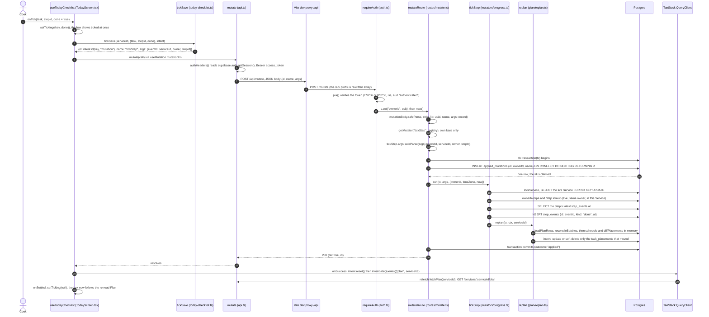
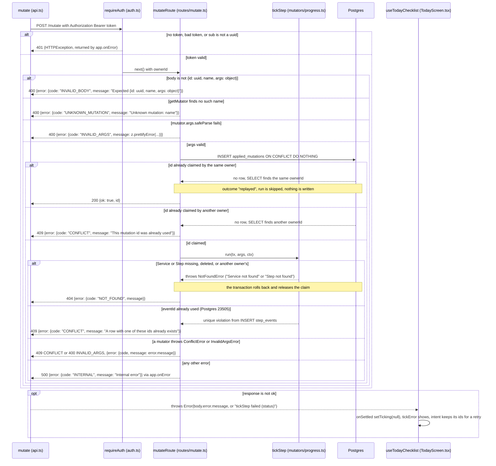

# Mutation lifecycle

Every write in MiseFlow is one named mutation `{id, name, args}` sent to the single endpoint
`POST /mutate` ([ADR 0007](../../adr/0007-writes-are-named-mutations-to-one-endpoint.md)). These
diagrams follow one real mutation, `tickStep`, from the cook ticking a Step on the Today checklist
to the re-read Plan. The first diagram is the happy path, the second the ways the request can fail.

## Happy path: ticking a Step

`tickSave` builds the call. `intent.id(key, ...)` makes the mutation id and the `eventId` once per
intended tick (`key` is the Task key, Step id and `done`), so a retry after a lost response sends
the same ids and is replayed, not applied twice. `intent.reset()` runs only after a success.

On the server, the mutation id is claimed in `applied_mutations` inside the same transaction as the
mutator's writes. If `run` throws, the transaction rolls back and the claim goes with it, so a retry
can apply the mutation. `tickStep` appends a `done` event to the append-only `step_events` and then
re-plans the Service with `replan`, which locks the Service again and writes only the
`task_placements` that moved. `untickStep` is the same with `kind: "undone"`.

The Vite proxy exists only in development (`web/vite.config.ts`): the API's routes sit at the root,
and `/api` is the proxy's prefix.

## Error paths

`tickStep` itself only throws `NotFoundError` or hits a unique violation. `ConflictError` and
`InvalidArgsError` come from other mutators (an Ingredient name already taken, a unit of the wrong
kind), but every mutation shares this route, so their mappings are shown. A replayed id returns the
same `200 {ok: true, id}` as a first apply, without comparing args: the browser must send a new id
whenever the args change, which is what `intent.id` keyed on the tick does.

## Source files

- [docs/adr/0007-writes-are-named-mutations-to-one-endpoint.md](../../adr/0007-writes-are-named-mutations-to-one-endpoint.md): the decision
- [web/src/TodayScreen.tsx](../../../web/src/TodayScreen.tsx): `useTodayChecklist`, its `useMutation`, `onSuccess` and `onSettled`
- [web/src/today-checklist.ts](../../../web/src/today-checklist.ts): `tickSave`, `tickKey`, `Ticking`
- [web/src/intent.ts](../../../web/src/intent.ts): `createIntent`, `useIntent`, ids reused by a retry
- [web/src/mutation-call.ts](../../../web/src/mutation-call.ts): the `MutationCall` type
- [web/src/api.ts](../../../web/src/api.ts): `mutate`, `authHeaders`, `fetchPlan`
- [web/vite.config.ts](../../../web/vite.config.ts): the `/api` dev proxy
- [server/src/app.ts](../../../server/src/app.ts): `createApp`, `requireAuth` on every route but `/health`, `app.onError`
- [server/src/auth.ts](../../../server/src/auth.ts): `requireAuth`, the JWKS cache
- [server/src/routes/mutate.ts](../../../server/src/routes/mutate.ts): `mutateRoute`, `mutationBody`, the claim and outcomes, `isUniqueViolation`
- [server/src/errors.ts](../../../server/src/errors.ts): `errorBody` and the error codes
- [shared/src/mutators/registry.ts](../../../shared/src/mutators/registry.ts): `mutators`, `getMutator`
- [shared/src/mutators/define.ts](../../../shared/src/mutators/define.ts): `Mutator`, `MutatorContext`, `NotFoundError`, `ConflictError`, `InvalidArgsError`
- [shared/src/mutators/progress.ts](../../../shared/src/mutators/progress.ts): `tickStep`, `untickStep`, `appendEvent`
- [shared/src/plan/replan.ts](../../../shared/src/plan/replan.ts): `lockService`, `replan`, `replanWith`
- [shared/src/schema.ts](../../../shared/src/schema.ts): `applied_mutations`, `step_events`, `task_placements`
