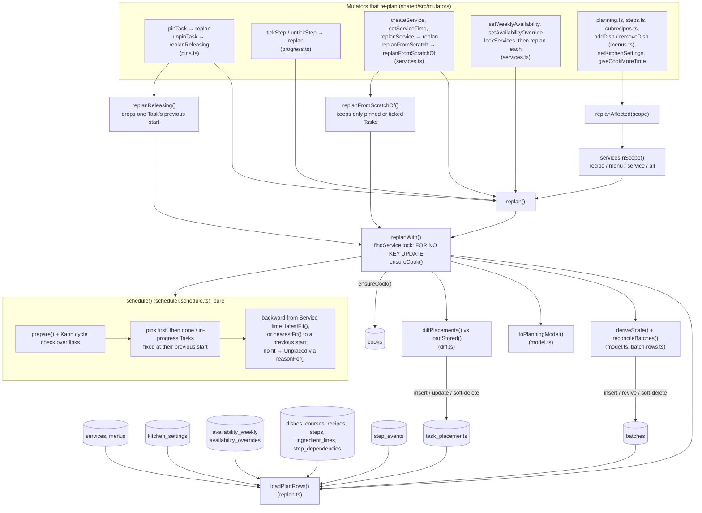
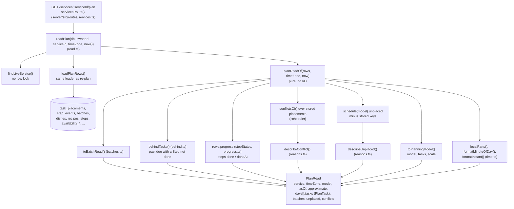
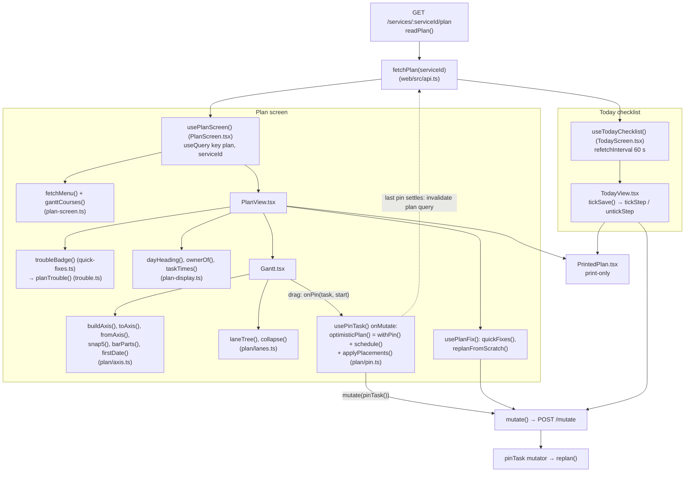

# Plan read and re-plan

A Service's Plan is stored as one `task_placements` row per placed Task. Mutators that change a
Task re-plan inside their own transaction and write only what moved. The Plan read never writes:
it lays out the stored rows and works out progress, behind, Unplaced Tasks and conflicts each time
it is read. The web app shows that read as a Gantt chart, day lists, a printed Plan and the Today
checklist. Dragging a bar pins the Task, and the browser runs the same scheduler to show the
result straight away.

## 1. Re-plan: computing and storing the Plan

A re-plan always runs inside the calling mutator's transaction. There are three ways in:

- `replan(serviceId)` re-plans one Service.
- `replanAffected(scope)` finds every live Service using a Recipe, a Menu, or all of them (`servicesInScope`) and calls `replan` on each.
- The variants `replanReleasing` (used by `unpinTask`) and `replanFromScratchOf` (used by `replanFromScratch`) change which stored placements reach the scheduler as `previous`.

All three end in `replanWith()`, which does this:

1. Locks the Service row.
2. Makes sure the implicit Cook row exists.
3. Loads every row the Plan needs (`loadPlanRows`). Recipe rows come through `loadScaleRows` / `loadRecipeSnapshot`, Step progress comes from `step_events`, and the stored placements become `previous`.
4. Makes the `batches` rows match the sub-recipes in use.
5. Builds the `PlanningModel` and runs the pure `schedule()`.
6. Diffs the result against every stored `task_placements` row, soft-deleted ones included. Only rows that moved are written.

`schedule()` places pins first, then done and in-progress Tasks. It then places the remaining Tasks backward from Service time in the Cook's free time. A Task that has a previous start is placed as close to it as it fits (`nearestFit`), and any other Task as late as it fits (`latestFit`). A Task with no room becomes Unplaced, with a reason. Shelf life (`keepsOf`) and progress bounds (`progressBounds`) can shift a Task's window.

Notes:
- `pinTask` and `unpinTask` write `pinned` and `startMinute` on the `task_placements` row themselves before re-planning, because the diff writes only the start and the Cook.
- `setDishScale` (menus.ts) does not call a re-plan.

## 2. Plan read: `readPlan` (no writes)

`readPlan` loads the same rows as a re-plan, without a lock, and hands them to the pure
`planReadOf`. Placed Tasks come straight from the stored `task_placements` rows (`rows.previous`)
and are grouped into days in the kitchen's time zone. Each `PlanTask` gets its Steps with
`done` / `doneAt`, and a `behind` block if `behindTasks()` measures it as late at `now`. Unplaced
Tasks and conflicts are not stored. They are worked out on each read: one `schedule()` run gives
the Unplaced Tasks that have no stored row, `conflictsOf()` checks the stored placements, and
`reasons.ts` turns both into sentences. The read also returns `model` (with `previous` sorted by
key), so the browser can run the same scheduler for an optimistic pin.

`readPlan` does not call `trouble.ts` or `lanes.ts`. The browser calls them (see below).
`more-time.ts` (`smallestOverride`) is used only by the `giveCookMoreTime` mutator.

## 3. Web side: showing and pinning the Plan

`usePlanScreen` and `useTodayChecklist` both read the same stored Plan through `fetchPlan`, under
the query key `["plan", serviceId]`. `PlanView` and `TodayView` both render `PrintedPlan`, which
is shown only in print. The Gantt chart is our own component (ADR 0009). It uses `axis.ts` for the
time axis with nights removed and `lanes.ts` for the Course → Dish → Batch lanes, which take their
Courses from the Menu (`ganttCourses`).

Dragging a bar snaps the new start to 5 minutes and calls `onPin`. `usePinTask` then:

1. Sends the `pinTask` mutation through `POST /mutate`. On the server, the mutator re-plans.
2. Meanwhile shows an optimistic Plan, by running the shared scheduler in the browser over `read.model` with the new pin.
3. Reads the Plan again once the last pending pin settles, so the stored Plan wins.

Quick fixes, "Re-plan from scratch" and Today ticks are not shown optimistically. They wait for the server and then read the Plan again.

## Source files

- [shared/src/plan/replan.ts](../../../shared/src/plan/replan.ts)
- [shared/src/plan/read.ts](../../../shared/src/plan/read.ts)
- [shared/src/plan/model.ts](../../../shared/src/plan/model.ts)
- [shared/src/plan/batch-rows.ts](../../../shared/src/plan/batch-rows.ts)
- [shared/src/plan/batches.ts](../../../shared/src/plan/batches.ts)
- [shared/src/plan/diff.ts](../../../shared/src/plan/diff.ts)
- [shared/src/plan/progress.ts](../../../shared/src/plan/progress.ts)
- [shared/src/plan/behind.ts](../../../shared/src/plan/behind.ts)
- [shared/src/plan/reasons.ts](../../../shared/src/plan/reasons.ts)
- [shared/src/plan/trouble.ts](../../../shared/src/plan/trouble.ts)
- [shared/src/plan/lanes.ts](../../../shared/src/plan/lanes.ts)
- [shared/src/plan/axis.ts](../../../shared/src/plan/axis.ts)
- [shared/src/plan/pin.ts](../../../shared/src/plan/pin.ts)
- [shared/src/plan/time.ts](../../../shared/src/plan/time.ts)
- [shared/src/plan/more-time.ts](../../../shared/src/plan/more-time.ts)
- [shared/src/recipe/snapshot.ts](../../../shared/src/recipe/snapshot.ts)
- [shared/src/scheduler/schedule.ts](../../../shared/src/scheduler/schedule.ts)
- [shared/src/scheduler/types.ts](../../../shared/src/scheduler/types.ts)
- [shared/src/scheduler/timeline.ts](../../../shared/src/scheduler/timeline.ts)
- [shared/src/mutators/pins.ts](../../../shared/src/mutators/pins.ts)
- [shared/src/mutators/progress.ts](../../../shared/src/mutators/progress.ts)
- [shared/src/mutators/planning.ts](../../../shared/src/mutators/planning.ts)
- [shared/src/mutators/services.ts](../../../shared/src/mutators/services.ts)
- [shared/src/mutators/menus.ts](../../../shared/src/mutators/menus.ts)
- [shared/src/mutators/steps.ts](../../../shared/src/mutators/steps.ts)
- [shared/src/mutators/subrecipes.ts](../../../shared/src/mutators/subrecipes.ts)
- [server/src/routes/services.ts](../../../server/src/routes/services.ts)
- [web/src/api.ts](../../../web/src/api.ts)
- [web/src/PlanScreen.tsx](../../../web/src/PlanScreen.tsx)
- [web/src/plan-screen.ts](../../../web/src/plan-screen.ts)
- [web/src/PlanView.tsx](../../../web/src/PlanView.tsx)
- [web/src/plan-display.ts](../../../web/src/plan-display.ts)
- [web/src/Gantt.tsx](../../../web/src/Gantt.tsx)
- [web/src/quick-fixes.ts](../../../web/src/quick-fixes.ts)
- [web/src/PrintedPlan.tsx](../../../web/src/PrintedPlan.tsx)
- [web/src/TodayScreen.tsx](../../../web/src/TodayScreen.tsx)
- [web/src/TodayView.tsx](../../../web/src/TodayView.tsx)
- [web/src/today-checklist.ts](../../../web/src/today-checklist.ts)
- [docs/adr/0009-build-our-own-gantt-chart.md](../../adr/0009-build-our-own-gantt-chart.md)
