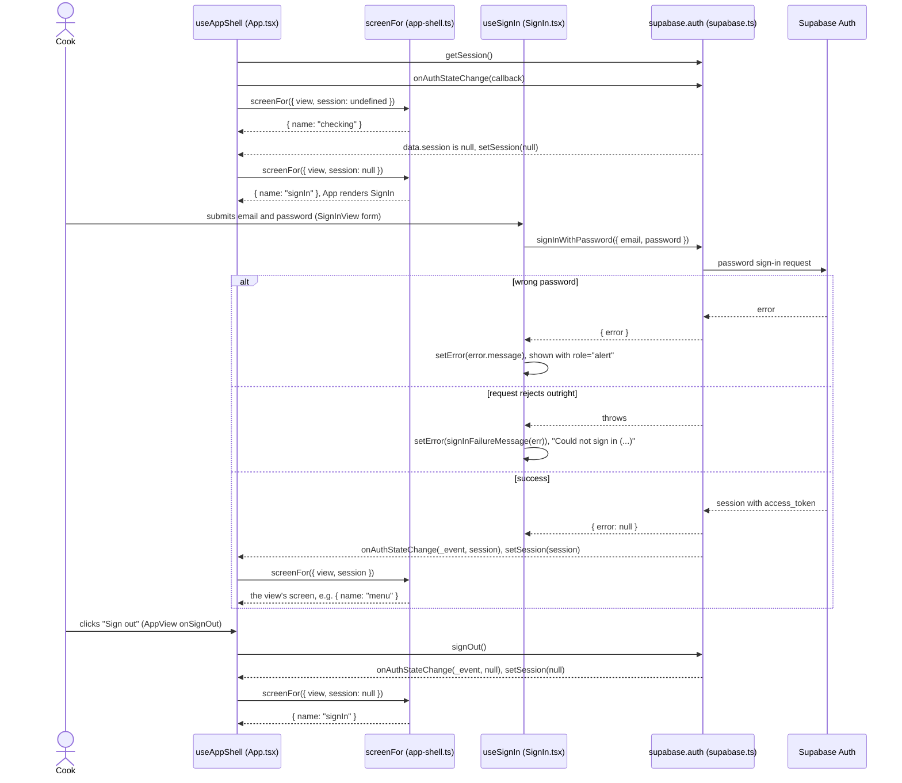
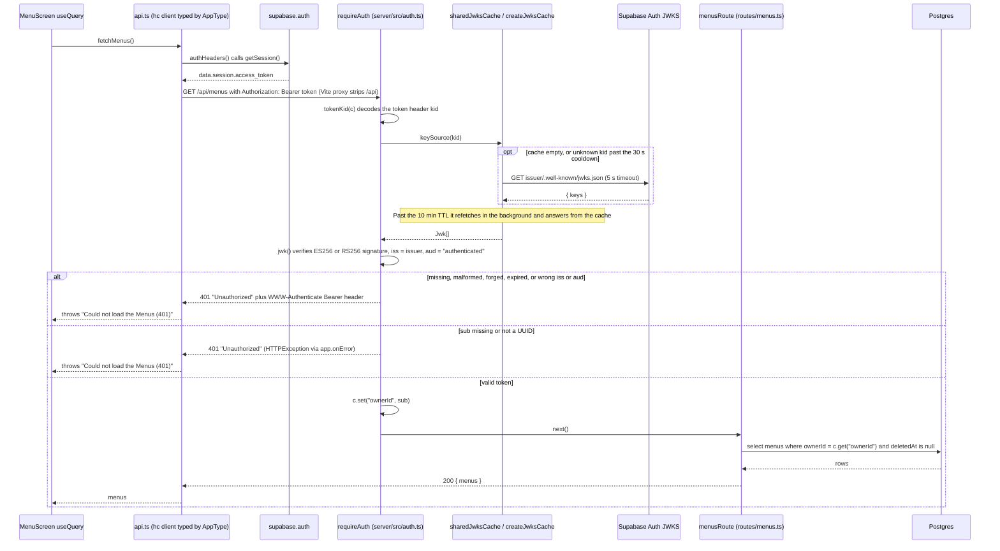

# Sign-in and request auth

MiseFlow signs its single user in with Supabase Auth (email and password), and the Hono API checks
the Supabase access token on every request without calling Supabase per request
([ADR 0008](../../adr/0008-sign-in-with-supabase-auth.md)). The flow is split in two diagrams: the
browser side (session check, sign-in, sign-out) and one authenticated read through the server.

## 1. Browser: session check, sign-in and sign-out

## 2. Server: an authenticated read (`GET /menus`)

## How it works

**Browser.** `useAppShell` holds the session as Supabase last reported it: `undefined` until the
first `getSession()` resolves, then a `Session` or `null`. `screenFor` turns that into the
`checking` screen, the `signIn` screen, or the open view's screen. `useSignIn` only calls
`signInWithPassword` and shows an error; a successful sign-in reaches the shell through
`onAuthStateChange`, not through the sign-in hook. A Supabase `{ error }` (such as a wrong password)
shows Supabase's own message; a request that rejects shows `signInFailureMessage`'s
"Could not sign in (...)". Sign-out calls `supabase.auth.signOut()` and the shell falls back to
`signIn` through the same listener. supabase-js is used only for auth, never for data
(ADR 0006, ADR 0008).

**Every request.** `api.ts` builds the Hono RPC client with `headers: authHeaders`, so each call
reads the current session and sends `Authorization: Bearer <access_token>`. `mutate()` adds the same
header to its plain `fetch` to `/api/mutate`. In development the Vite proxy strips `/api`, since the
API's routes sit at the root.

**Server.** `createApp` registers `GET /health` as public, then `app.use("*", requireAuth(auth))`
guards every other route. `requireAuth` wraps Hono's `jwk()` with keys from a JWKS cache keyed by
`<SUPABASE_URL>/auth/v1/.well-known/jwks.json` (one cache per URL per process). The cache keeps keys
for 10 minutes, refetches early for an unknown `kid` (key rotation), waits at least 30 s between
fetches once it has keys, shares one in-flight fetch, and keeps serving the old keys when a refetch
fails. After `jwk()` accepts the token, `sub` must be a UUID; it becomes `ownerId`, and every route
filters its rows by it (for example `eq(menus.ownerId, c.get("ownerId"))`).

**Failure bodies.** A token `jwk()` rejects gets Hono's response: status 401, plain-text body
`Unauthorized`, and a `WWW-Authenticate: Bearer ... error="invalid_token"` header (or
`error="invalid_request"` when the header is missing or not `Bearer <token>`). A bad `sub` throws
`HTTPException(401, { message: "Unauthorized" })`, which `app.onError` returns as a 401 with body
`Unauthorized`. If the JWKS cannot be fetched while the cache is still empty, `jwk()` rethrows the
plain error and `app.onError` answers 500 with `{ error: { code: "INTERNAL", message: "Internal error" } }`.

## Source files

- [docs/adr/0008-sign-in-with-supabase-auth.md](../../adr/0008-sign-in-with-supabase-auth.md)
- [web/src/App.tsx](../../../web/src/App.tsx) (`useAppShell`)
- [web/src/app-shell.ts](../../../web/src/app-shell.ts) (`screenFor`)
- [web/src/SignIn.tsx](../../../web/src/SignIn.tsx) (`useSignIn`, `SignInView`)
- [web/src/sign-in.ts](../../../web/src/sign-in.ts) (`signInFailureMessage`)
- [web/src/supabase.ts](../../../web/src/supabase.ts)
- [web/src/api.ts](../../../web/src/api.ts) (`authHeaders`, `api`, `fetchMenus`, `mutate`)
- [web/src/MenuScreen.tsx](../../../web/src/MenuScreen.tsx) (the `useQuery` that calls `fetchMenus`)
- [web/vite.config.ts](../../../web/vite.config.ts) (the `/api` dev proxy)
- [server/src/auth.ts](../../../server/src/auth.ts) (`requireAuth`, `tokenKid`, `createJwksCache`, `sharedJwksCache`)
- [server/src/app.ts](../../../server/src/app.ts) (`createApp`, `app.onError`)
- [server/src/env.ts](../../../server/src/env.ts) (`authConfigFromEnv`, the issuer)
- [server/src/index.ts](../../../server/src/index.ts)
- [server/src/routes/menus.ts](../../../server/src/routes/menus.ts)
- [server/test/auth.test.ts](../../../server/test/auth.test.ts) (the 401 cases)
