# System context

The four moving parts of MiseFlow (the React SPA, the Hono API, Supabase Auth and Postgres), who
talks to whom, and where each run gets its settings from.

```mermaid
flowchart LR
    subgraph Browser["Browser"]
        SPA["React SPA (web/)<br/>web/src/api.ts: hc client on /api, mutate()"]
        SJS["supabase-js auth only<br/>web/src/supabase.ts<br/>signInWithPassword, getSession"]
        SPA --- SJS
    end

    subgraph Dev["Vite dev server (web/vite.config.ts)"]
        Proxy["server.proxy '/api'<br/>strips the /api prefix"]
    end

    subgraph Server["Hono API on Node (server/)"]
        Entry["server/src/index.ts<br/>serve() from @hono/node-server"]
        Gate["prodStartupRefusal()<br/>server/src/prod-gate.ts"]
        App["createApp() server/src/app.ts<br/>GET /health (public)"]
        Auth["requireAuth() server/src/auth.ts<br/>jwk() + JWKS cache, sets ownerId"]
        Routes["/mutate, /menus, /recipes,<br/>/ingredients, /shopping-categories,<br/>/services, /availability"]
        DbMod["createDb() server/src/db.ts<br/>Drizzle + postgres.js"]
        Entry --> Gate
        Entry --> App
        App --> Auth --> Routes --> DbMod
    end

    subgraph Supa["Supabase (local stack for test, hosted project for prod)"]
        GoTrue["Supabase Auth<br/>SUPABASE_URL/auth/v1"]
        JWKS["/auth/v1/.well-known/jwks.json"]
        PG[("Postgres<br/>schema from drizzle-kit migrations")]
    end

    subgraph Env["Env files at the repo root (ADR 0012)"]
        Loader["scripts/env.ts<br/>loadEnv(APP_ENV)"]
        EnvTest[".env.test<br/>APP_ENV unset or test"]
        EnvProd[".env.prod<br/>APP_ENV=prod"]
        EnvTest --> Loader
        EnvProd --> Loader
    end

    SJS -- "email + password sign-in,<br/>session refresh" --> GoTrue
    SPA -- "fetch /api/... with<br/>Authorization: Bearer token" --> Proxy
    Proxy -- "http://localhost:API port" --> Entry
    Auth -- "fetch keys, cached 10 min" --> JWKS
    DbMod -- "DATABASE_URL" --> PG
    Gate -. "prod only: pending migrations?" .-> PG

    Loader -- "viteEnv(): VITE_SUPABASE_URL,<br/>VITE_SUPABASE_PUBLISHABLE_KEY" --> Dev
    Loader -- "scripts/load-env.ts: SUPABASE_URL,<br/>DATABASE_URL, KITCHEN_TIME_ZONE" --> Entry
```

## How it fits together

- **Browser.** The React SPA calls the API through Hono's typed RPC client (`hc<AppType>("/api")`)
  for reads and a plain `fetch("/api/mutate")` for writes (ADR 0007). The only Supabase code in the
  browser is supabase-js's auth module: `SignIn.tsx` calls `signInWithPassword`, and `authHeaders()`
  in `api.ts` attaches the session's access token as a bearer token. The browser never uses
  Supabase's data API (ADR 0006, ADR 0008).
- **Dev proxy.** In development, Vite serves the SPA and proxies `/api` to this checkout's API port
  (8787 in the main checkout for test), stripping the prefix, because the API's routes sit at the
  root (`/mutate`, `/menus`, ...).
- **Hono API.** `index.ts` loads the env, runs the prod startup gate, builds the app with
  `createApp()` and serves it on Node. `/health` is public; every other route goes through
  `requireAuth()`, which checks the token with Hono's `jwk()` middleware against the project's
  public keys (issuer `<SUPABASE_URL>/auth/v1`, audience `authenticated`). It does not call Supabase
  per request: the JWKS is cached for 10 minutes and refetched early for an unknown `kid`. The
  token's `sub` becomes `ownerId`, the value of every row's owner column.
- **Postgres.** Only the server reaches the database, through Drizzle over postgres.js
  (`createDb(DATABASE_URL)`). drizzle-kit is the only migration tool; Supabase CLI migrations are
  not used. With `APP_ENV=prod` the server refuses to start while migrations are pending.
- **Two environments.** `APP_ENV` picks exactly one git-ignored file: `.env.test` (unset or `test`)
  points at the local Supabase stack started by `npm run setup:local` (API on port 54321, Postgres
  on 54322 per `supabase/config.toml`); `.env.prod` points at the hosted Supabase project, whose
  `DATABASE_URL` must be the session pooler. One loader, `scripts/env.ts`, serves the server (via
  `scripts/load-env.ts`) and Vite (via `viteEnv()`, which passes only `VITE_`-prefixed names to the
  browser; Vite's own env loading is off with `envDir: false`).

## Source files

- [web/vite.config.ts](../../../web/vite.config.ts)
- [web/src/api.ts](../../../web/src/api.ts)
- [web/src/supabase.ts](../../../web/src/supabase.ts)
- [web/src/SignIn.tsx](../../../web/src/SignIn.tsx)
- [server/src/index.ts](../../../server/src/index.ts)
- [server/src/app.ts](../../../server/src/app.ts)
- [server/src/auth.ts](../../../server/src/auth.ts)
- [server/src/db.ts](../../../server/src/db.ts)
- [server/src/env.ts](../../../server/src/env.ts)
- [server/src/prod-gate.ts](../../../server/src/prod-gate.ts)
- [scripts/env.ts](../../../scripts/env.ts)
- [scripts/load-env.ts](../../../scripts/load-env.ts)
- [supabase/config.toml](../../../supabase/config.toml)
- [README.md](../../../README.md)
- ADRs: [0005](../../adr/0005-react-spa-with-a-thin-hono-api.md),
  [0006](../../adr/0006-supabase-postgres-through-drizzle.md),
  [0008](../../adr/0008-sign-in-with-supabase-auth.md),
  [0012](../../adr/0012-one-env-file-per-environment.md)
