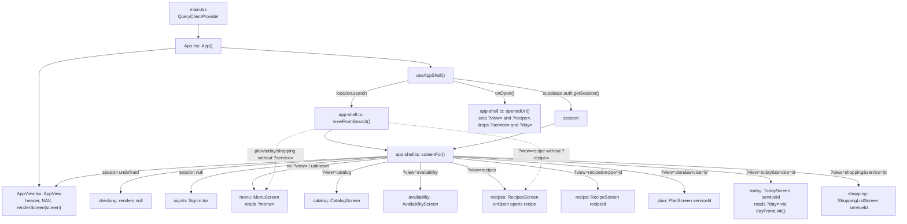
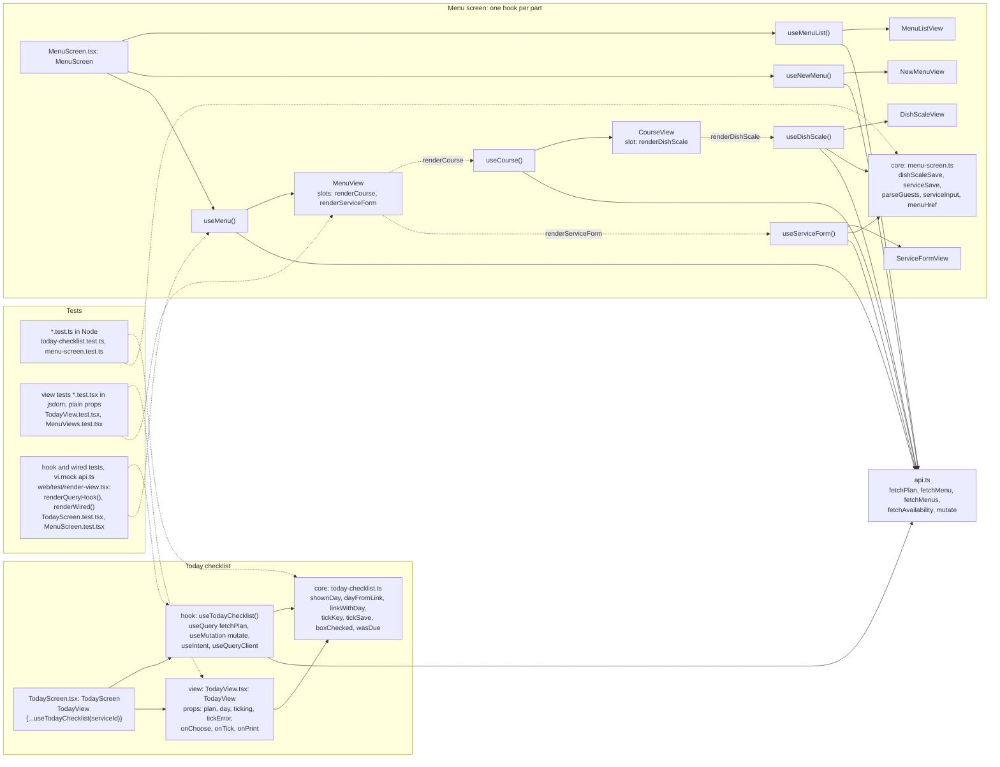

# Web screens

## Navigation: the `?view=` query string

There is no router. `useAppShell()` in `App.tsx` reads the open view from the query string through `viewFromSearch()`, turns it into a `Screen` with `screenFor()`, and `App` renders that screen inside `AppView`. Opening another view calls `openedUrl()` and `history.replaceState`.

Fallbacks: `viewFromSearch()` turns `?view=recipe` without `?recipe=` into `recipes`, and `plan`, `today` or `shopping` without `?service=` into `menu`. `screenFor()` also falls back to `menu` when the view lacks its id. The `?day=` param is not read by the shell: `today-checklist.ts` reads it (`dayFromLink`) and writes it back (`linkWithDay`, `putShownDayInLink`). The open Menu lives in `?menu=`, read by `menuIdFromUrl()` in `MenuScreen.tsx`. The header's `NAV` offers Menu, Recipes, Catalog and Availability; Plan, Today and Shopping are reached by links carrying `?service=`.

## Core, hook and view (ADR 0011)

What each layer may call:

- **Core** (`*.ts`, e.g. `today-checklist.ts`, `menu-screen.ts`): pure TypeScript. Decisions, validation, formatting, and each named mutation's name and args (`tickSave`, `dishScaleSave`, `serviceSave` return a `MutationCall`). It imports only types from `api.ts`. Unit-tested in Node.
- **Hook** (`useTodayChecklist`, `useMenuList`, `useNewMenu`, `useMenu`, `useCourse`, `useDishScale`, `useServiceForm`): calls `useQuery`, `useMutation`, `useIntent`, `useQueryClient` and `api.ts`, and passes the core's results through, with no branches of its own. Tested through `renderQueryHook()` (the hook alone) or `renderWired()` (hook plus view), each inside a fresh QueryClient with `retry: false`, with only `./api.ts` faked by `vi.mock` (plus `./supabase.ts` for the app shell and sign-in).
- **View** (`TodayView`, `MenuViews.tsx`): props only, no fetching. A parent view takes nested parts as `render…` slot props (`renderCourse`, `renderServiceForm`, `renderDishScale`), which the wired component (`OpenMenu`, `OpenCourse` in `MenuScreen.tsx`) fills with the part's hook and view. Tested in jsdom with hand-written or core-computed props.
- The Playwright e2e covers the whole screen in a real browser.

## Every screen's files

| Screen (`view`) | Core | Hook(s) | View |
|---|---|---|---|
| App shell | `app-shell.ts` | `useAppShell` (`App.tsx`) | `AppView.tsx` |
| Sign-in (`signIn`) | `sign-in.ts` | `useSignIn` (`SignIn.tsx`) | `SignInView` (`SignIn.tsx`) |
| Menu (`menu`) | `menu-screen.ts` | `useMenuList`, `useNewMenu`, `useMenu`, `useCourse`, `useDishScale`, `useServiceForm` (`MenuScreen.tsx`) | `MenuViews.tsx` |
| Catalog (`catalog`) | `catalog-screen.ts` | `useCatalog`, `useAddAlias`, `useNewIngredient` (`CatalogScreen.tsx`) | `CatalogViews.tsx` |
| Availability (`availability`) | `availability-screen.ts` | `useAvailabilityScreen` (`AvailabilityScreen.tsx`) | `AvailabilityView.tsx` |
| Recipes (`recipes`) | none | `useRecipesScreen` (`RecipesScreen.tsx`) | `RecipesViews.tsx` |
| Recipe (`recipe`) | `recipe-screen.ts`, `recipe-edits.ts` | `useRecipeScreen` (`RecipeScreen.tsx`) | `RecipeViews.tsx` (`RecipeScreenView`) |
| Planning pass (part of Recipe) | `planning-pass.ts` | `usePlanningPass` (`PlanningPass.tsx`) | `PlanningPassView.tsx` |
| Plan (`plan`) | `plan-screen.ts` | `usePlanScreen`, `usePinTask`, `usePlanFix` (`PlanScreen.tsx`) | `PlanView.tsx` |
| Today (`today`) | `today-checklist.ts` | `useTodayChecklist` (`TodayScreen.tsx`) | `TodayView.tsx` |
| Shopping (`shopping`) | `shopping-list.ts` | `useShoppingList`, `useShoppingRow` (`ShoppingListScreen.tsx`) | `ShoppingListViews.tsx` |

## Source files

- [docs/adr/0011-web-screens-split-into-core-hook-and-view.md](../../adr/0011-web-screens-split-into-core-hook-and-view.md)
- [web/src/main.tsx](../../../web/src/main.tsx)
- [web/src/App.tsx](../../../web/src/App.tsx)
- [web/src/app-shell.ts](../../../web/src/app-shell.ts)
- [web/src/AppView.tsx](../../../web/src/AppView.tsx)
- [web/src/MenuScreen.tsx](../../../web/src/MenuScreen.tsx)
- [web/src/menu-screen.ts](../../../web/src/menu-screen.ts)
- [web/src/MenuViews.tsx](../../../web/src/MenuViews.tsx)
- [web/src/TodayScreen.tsx](../../../web/src/TodayScreen.tsx)
- [web/src/today-checklist.ts](../../../web/src/today-checklist.ts)
- [web/src/TodayView.tsx](../../../web/src/TodayView.tsx)
- [web/test/render-view.tsx](../../../web/test/render-view.tsx)
