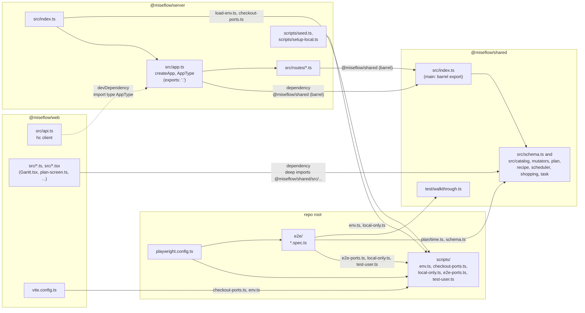
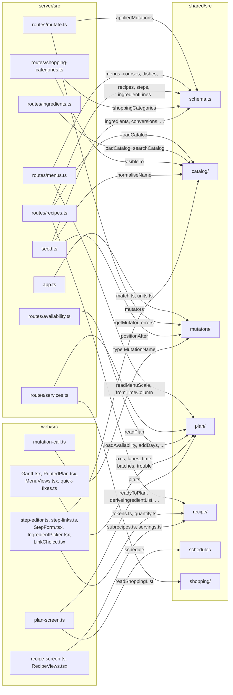
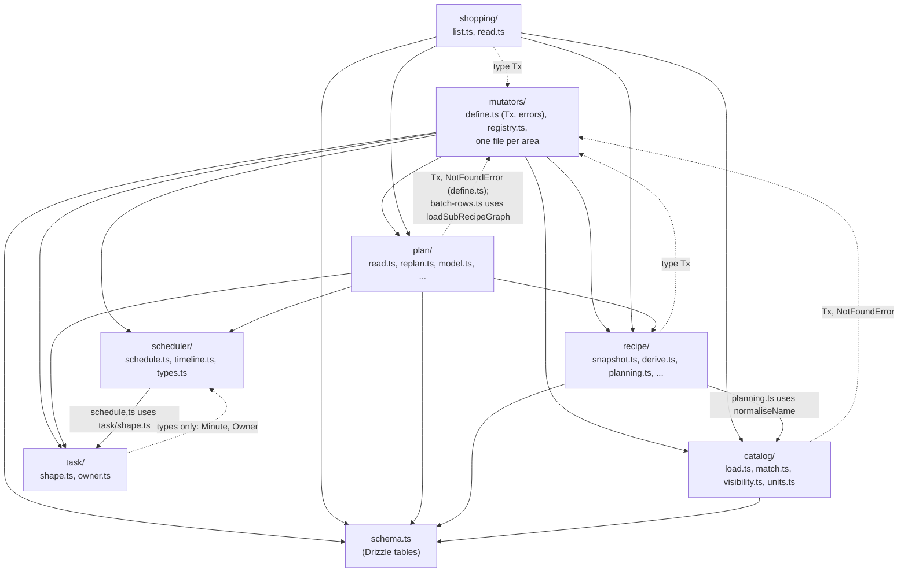

# Workspaces and modules

MiseFlow is one npm repo with three workspaces (`shared`, `server`, `web`, listed in the root
`package.json`) plus two root folders that are not workspaces: `scripts/` (dev and CI tooling) and
`e2e/` (Playwright specs). This page has three diagrams: how the workspaces depend on each other,
which `shared/src` folders the server and web code use, and how the `shared/src` folders depend on
each other.

## 1. Workspaces

- `server` and `web` both list `@miseflow/shared` as a dependency. `shared` depends on no other
  workspace. `web` lists `@miseflow/server` only as a devDependency, and uses it only for
  `import type { AppType } from "@miseflow/server"` in `web/src/api.ts`, which types the Hono
  `hc` client. No server code ships in the web bundle.
- The server imports everything from the `@miseflow/shared` barrel (`shared/src/index.ts`). The web
  never imports the barrel: it imports single files such as
  `@miseflow/shared/src/plan/axis.ts`. Some of those files (`plan/axis.ts`, `plan/lanes.ts`,
  `plan/pin.ts`, `plan/trouble.ts`, `recipe/servings.ts`) are not in the barrel at all.
- `scripts/` imports nothing from the workspaces; the workspaces, `e2e/` and
  `playwright.config.ts` import helpers from it. The root `build` script builds `shared`, then
  `web`, then `server`.

## 2. Which shared folders the server and web use

- Every write goes through `mutators/` (the server's `POST /mutate` route looks the mutator up with
  `getMutator`), and the web only names a mutation by type (`MutationName` in `mutation-call.ts`).
- Read routes call read functions in `shared`: `readPlan` (`plan/read.ts`), `readShoppingList`
  (`shopping/read.ts`), `readyToPlan` and `deriveIngredientList` (`recipe/`), `loadCatalog`
  (`catalog/load.ts`).
- The web reuses pure functions to work without a round trip: the Gantt chart layout
  (`plan/axis.ts`, `plan/lanes.ts`), pinning and re-scheduling locally in `plan-screen.ts`
  (`plan/pin.ts`, `scheduler/schedule.ts`), and Step text parsing (`recipe/tokens.ts`,
  `recipe/quantity.ts`, `catalog/match.ts`).
- `task/` is not imported directly by server or web code; it reaches them through `scheduler/` and
  `plan/` (the barrel exports only `ownerSchema` from `task/owner.ts`).

## 3. Dependencies between shared folders

- Solid arrows are the main direction: `mutators/` sits on top and uses the domain folders;
  `plan/` builds on `scheduler/` and `task/`; nearly everything reads tables from `schema.ts`.
- Dotted arrows go "upward" and are mostly small: the read functions in `catalog/`, `recipe/`,
  `plan/` and `shopping/` take the transaction type `Tx` and throw `NotFoundError`, both defined in
  `mutators/define.ts`. The one real function call is `plan/batch-rows.ts` calling
  `loadSubRecipeGraph` from `mutators/subrecipes.ts`.
- `scheduler/` and `task/` import each other: `scheduler/schedule.ts` uses `task/shape.ts`, while
  `task/shape.ts` and `scheduler/types.ts` share the `Minute` and `Owner` types.
- Test files (`*.test.ts`) and `scheduler/fixtures.ts` are left out of this diagram.

## Source files

- [package.json](../../../package.json)
- [shared/package.json](../../../shared/package.json)
- [server/package.json](../../../server/package.json)
- [web/package.json](../../../web/package.json)
- [playwright.config.ts](../../../playwright.config.ts)
- [shared/src/index.ts](../../../shared/src/index.ts)
- [shared/src/schema.ts](../../../shared/src/schema.ts)
- [shared/src/mutators/define.ts](../../../shared/src/mutators/define.ts)
- [shared/src/mutators/registry.ts](../../../shared/src/mutators/registry.ts)
- [shared/src/plan/read.ts](../../../shared/src/plan/read.ts)
- [shared/src/plan/replan.ts](../../../shared/src/plan/replan.ts)
- [shared/src/plan/batch-rows.ts](../../../shared/src/plan/batch-rows.ts)
- [shared/src/scheduler/schedule.ts](../../../shared/src/scheduler/schedule.ts)
- [shared/src/scheduler/types.ts](../../../shared/src/scheduler/types.ts)
- [shared/src/task/shape.ts](../../../shared/src/task/shape.ts)
- [shared/src/shopping/read.ts](../../../shared/src/shopping/read.ts)
- [shared/src/recipe/planning.ts](../../../shared/src/recipe/planning.ts)
- [shared/test/walkthrough.ts](../../../shared/test/walkthrough.ts)
- [server/src/app.ts](../../../server/src/app.ts)
- [server/src/index.ts](../../../server/src/index.ts)
- [server/src/seed.ts](../../../server/src/seed.ts)
- [server/src/routes/](../../../server/src/routes/)
- [server/scripts/setup-local.ts](../../../server/scripts/setup-local.ts)
- [web/src/api.ts](../../../web/src/api.ts)
- [web/src/Gantt.tsx](../../../web/src/Gantt.tsx)
- [web/src/plan-screen.ts](../../../web/src/plan-screen.ts)
- [web/src/step-editor.ts](../../../web/src/step-editor.ts)
- [web/src/mutation-call.ts](../../../web/src/mutation-call.ts)
- [web/vite.config.ts](../../../web/vite.config.ts)
